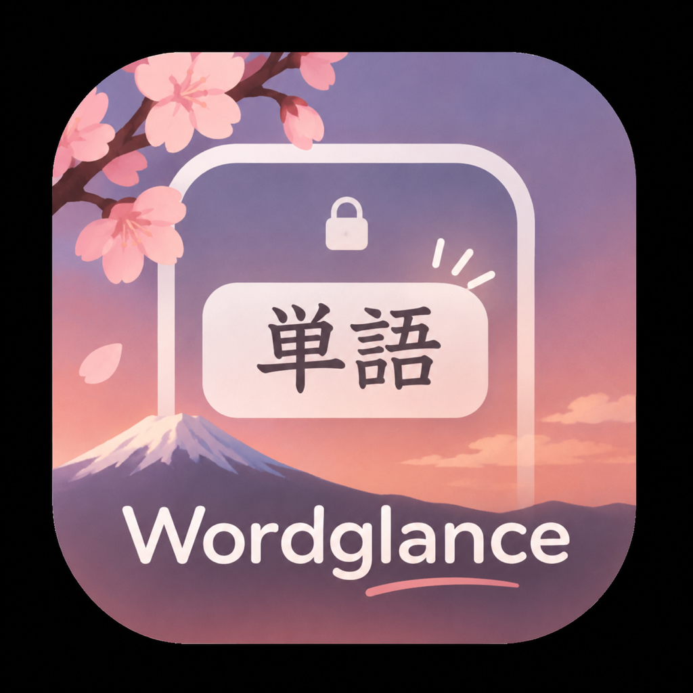
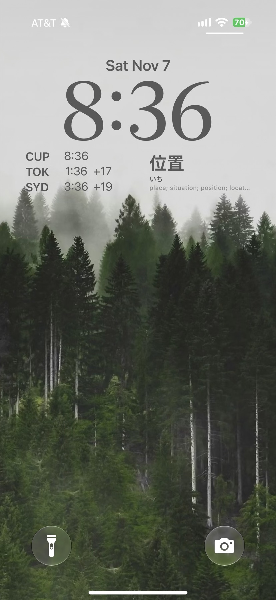
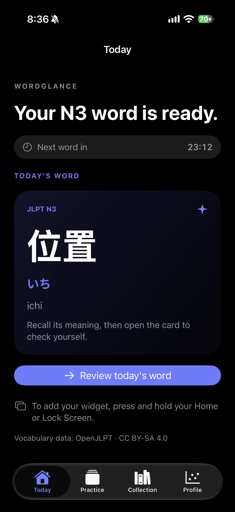
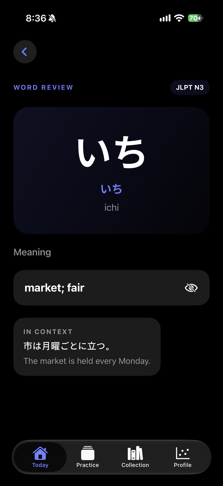
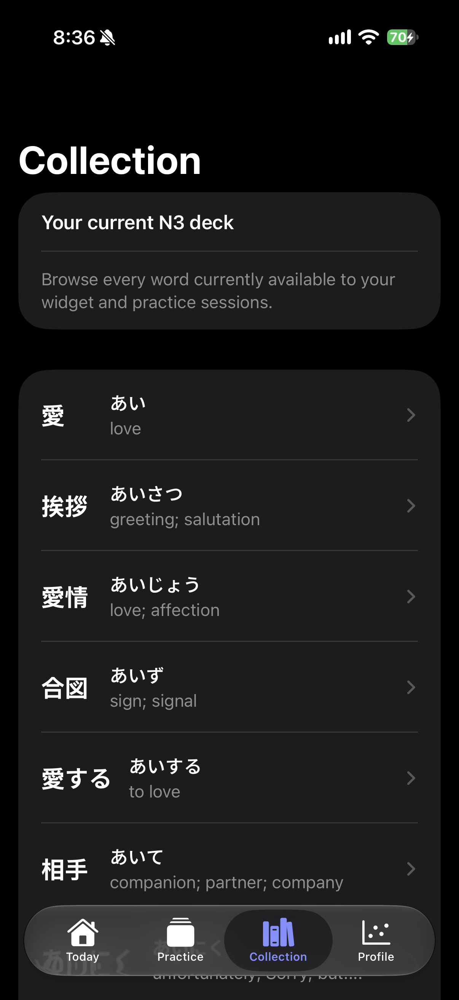
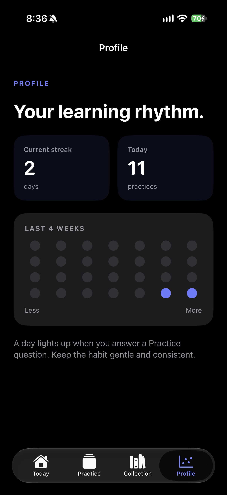

<p align="center">
  
</p>

<h1 align="center">WordGlance</h1>

<p align="center">
  <strong>A quiet Japanese vocabulary habit, right where you already look.</strong><br>
  Learn one JLPT word at a time from your iPhone Home Screen or Lock Screen.
</p>

<p align="center">
  
  
  
</p>

<p align="center">
  
  
  
  
  
</p>

## Learn in the margins of your day

WordGlance turns the Lock Screen and Home Screen into a gentle prompt to learn Japanese. Choose a JLPT level, set the hours you want to study, and a fresh word appears on a schedule you control. When you have a moment, tap in for a focused review or a quick recall challenge.

The goal is simple: make vocabulary visible often enough that it sticks—without turning language learning into another noisy obligation.

## Built around a single, shared word

| | |
| --- | --- |
| **A word at the right pace** | Choose a new word every 30 minutes, hourly, every 2 or 4 hours, or once daily. The Today screen shows a live countdown to the next word. |
| **Your level, not a generic feed** | Select JLPT N5 through N1. Each active deck has 100 Japanese vocabulary entries, with katakana-only loanwords excluded from rotation. |
| **Widget and app stay in sync** | The same current word appears in the app and WidgetKit widget, so there is no context switch when you tap in. |
| **Recall before revealing** | Review cards keep the meaning hidden until you are ready. Practice mode uses randomized, non-repeating multiple-choice distractors. |
| **A visible learning rhythm** | Track practice activity, daily momentum, and your current streak in Profile. |

## Product tour

The Lock Screen is the heart of WordGlance. The app exists to bring a useful Japanese word into the moments between everything else.

### 1. Lock Screen — let Japanese find you


The Lock Screen widget places the kanji, reading, and a compact definition beside the time—so a study moment can happen without opening an app.

### 2. Today — meet the current word


Today centers the active word, its reading, and a live countdown to the next one. The card invites recall before showing the answer.

### 3. Word Review — reveal meaning in context


Review reveals the definition only when you choose, then adds a Japanese example and English translation for context.

### 4. Collection — browse your current deck


Collection keeps your selected JLPT deck within reach. Browse every available word, then open any card for a closer review.

### 5. Profile — make consistency visible


Profile frames progress as a rhythm rather than a score. A four-week activity view, current streak, and today’s practices make it easy to notice the habit taking shape.

## Vocabulary coverage

WordGlance currently includes **500 curated starter entries**:

| JLPT level | Entries |
| --- | ---: |
| N5 | 100 |
| N4 | 100 |
| N3 | 100 |
| N2 | 100 |
| N1 | 100 |

Each entry includes Japanese writing, kana reading, romaji, an English meaning, and—when available—a Japanese example sentence with translation.

## Run it locally

### Requirements

- macOS with Xcode 26 or later
- An iPhone running iOS 26 or later for on-device widget testing
- An Apple ID signed into Xcode. A free Personal Team is enough for testing on your own device.

### Setup

1. Open `WordGlance.xcodeproj` in Xcode.
2. Choose the **WordGlance** scheme and your connected iPhone.
3. Under **Signing & Capabilities**, select your Apple ID for both the app and widget extension.
4. Confirm both targets use the App Group `group.com.brycehills.WordGlance`.
5. Press **Run**.
6. Add the WordGlance widget from the Home Screen or Lock Screen customization menu.

## Project structure

```text
WordGlance/                 Main SwiftUI iPhone app
WordGlanceWidget/           WidgetKit extension
docs/screenshots/           Product screenshots used in this README
WordGlance/WordBank.swift   Shared vocabulary model and schedule logic
WordGlanceWidget/WordBank.swift
                            Mirrored word bank used by the widget extension
```

## Vocabulary data & attribution

Vocabulary is sourced from [OpenJLPT](https://github.com/evanclan/OpenJLPT), licensed under [CC BY-SA 4.0](https://creativecommons.org/licenses/by-sa/4.0/). If you distribute or modify WordGlance’s vocabulary data, retain the required attribution and comply with the license’s share-alike terms.

## Status

WordGlance is an active early-stage iPhone prototype. The current focus is a polished daily-learning experience; production notification delivery, expanded vocabulary coverage, and App Store release work remain ahead.
